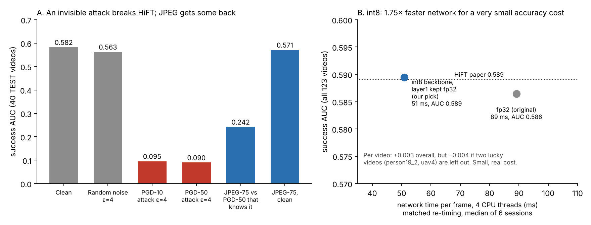

# HiFT stress test: all results at a glance

**Manzi's part of the AI6103 project:** adversarial robustness and edge cost.

**What we did:** we took HiFT (ICCV 2021, the aerial tracker we chose for Route 2), reproduced it on UAV123, and asked three questions:
1. Can it be fooled by small, invisible changes to the video?
2. Can it be made faster on a normal CPU without losing accuracy?
3. Does it know when it has lost the target?

Five rounds of tests, about 100 tracking runs on the TC2 cluster.

## Results in 30 seconds

| What we tested | What we found | Verdict |
|---|---|---|
| **Reproduce HiFT** (all 123 UAV123 videos) | Success 0.584 vs 0.589 in the paper; precision 0.780 vs 0.787 | ✅ Reproduced |
| **Invisible attack (PGD, each pixel changed by ≤ 4/255)** | Success drops from 0.58 to 0.10. Random noise of the same size barely matters (0.56). Same result over 3 seeds | ⚠️ HiFT is very easy to fool |
| **4 cheap input filters** (blur, median, bit-depth, JPEG) against an attacker who knows the filter | JPEG-75 works best. Against our strongest attacker it raises the worst case from 0.08 to 0.23 (+0.15); 26 videos better, none worse | ✅ Real protection… |
| …but the filter on normal video | Costs −0.012 success (JPEG-85: −0.030), just over our −0.010 limit. The cost comes from 2 fragile videos | ❌ Not free |
| **Compression: int8 backbone, first layer kept in full precision** | Network 1.75× faster on CPU (89 → 51 ms; tracker step 1.72×), measured in 6 matched sessions against the exact accuracy-tested model; model 25% smaller (44 → 33 MB). On all 123 videos, accuracy unchanged on average (+0.003); about −0.004 once two lucky videos are set aside | ✅ Our main improvement |
| Why keep layer 1 in full precision? (per-layer test, 20 DEV videos) | Quantising layer 1 alone distorts HiFT's score map most (error 0.013 vs 0.002–0.008 for layers 2–5, same in all 3 calibration draws). Tracking accuracy on DEV can't tell the placements apart (all intervals include zero) | ✅ Choice justified; no accuracy claim |
| Other compression | Whole backbone int8: 2.1× faster but −0.016 on average, depending on calibration videos. Full int8 including the attention head: 2.3× faster but −0.04 to −0.07. Pruning 50%: no speed-up and −0.13 | ❌ Dropped |
| int8 under 7 image corruptions (noise, blur, darkness, synthetic night…) | Hurts the same as the original model (extra loss −0.0035 on average) | ✅ As robust as the original |
| **Does HiFT know when it fails?** (its own confidence score) | Yes for normal failures: AUROC 0.97. When the alarm fires it is right 98% of the time, but it only catches 42% of failures, mostly after they start | ✅ Useful after-the-fact signal |
| Does the confidence score reveal attacks? | No. Under attack HiFT is *confidently* wrong: only 0.3% of attacked failures raised the alarm | ❌ Clear negative result |

## What we can write in the report

1. **Efficiency:** "Post-training int8 quantisation of HiFT's AlexNet-style backbone, keeping the first layer in full precision, makes the network 1.75× faster on a server CPU (4 threads; 1.81× with 1 thread) and 25% smaller. Average accuracy over all 123 UAV123 videos stays within 0.004 success AUC. A few small, fast targets (e.g. `uav2`) are the exception."
2. **Robustness:** "HiFT is highly vulnerable to imperceptible adversarial perturbations. A training-free JPEG input filter recovers part of the loss, even against an adaptive attacker, at a clean cost of about 1%."
3. **Failure awareness:** "HiFT's confidence score is a reliable after-the-fact failure detector (AUROC 0.97). It cannot detect adversarial attacks, because the attacked tracker stays confident."

**Do not claim:**
- Speed on drone hardware: we measured a server CPU.
- Real night-time performance: our night test is synthetic.
- Physical attacks.
- That JPEG is free.

**Update, 2 Nov:** the speed numbers come from a matched re-timing. It used the exact model whose accuracy was tested, ran fp32 and int8 in the same job, and repeated the measurement in alternating sessions. It replaces the earlier 1.80×, which came from an unmatched benchmark. Details: [`analysis/2026-11-02_retime-matched/`](analysis/2026-11-02_retime-matched/REVIEW.md). The HiFT code pin check (official commit `992aa7c`, only 4 device lines changed, confirmed on the cluster) is in [`analysis/2026-11-02_hift-pin-check/`](analysis/2026-11-02_hift-pin-check/PIN_CHECK.md). The per-layer test is in [`analysis/2026-11-03_layer-sensitivity/`](analysis/2026-11-03_layer-sensitivity/REVIEW.md).

## Why you can trust these numbers

- **Fixed test set:** the same 40 test videos every time (`attack-subset-40.json`). Settings such as the JPEG quality and the int8 recipe were chosen on 20 separate DEV videos.
- **Rules first:** pass/fail rules were written *before* each round ran (`ROUND*_PLAN.md`). A gate script cut ideas that failed, so nothing was tuned on the test set.
- **The accuracy limit:** −0.010 success, which is HiFT's own lead over SiamRPN++ in the paper.
- **Uncertainty:** every change is compared video-by-video, with 95% intervals over videos.
- **Independent checks:** every round was recomputed by an independent script from the raw boxes, and every file was hash-checked.

## Where everything is

| You want… | Look at |
|---|---|
| Every run's numbers in one table (103 runs) | [`analysis/all-rounds/all_runs.csv`](analysis/all-rounds/all_runs.csv) |
| Success per video for every run | [`analysis/all-rounds/per_video_success.csv`](analysis/all-rounds/per_video_success.csv) |
| The story round by round | Round 1 [first results](analysis/2026-10-17_first-results/REPORT.md) · Round 2 [defences + compression](analysis/2026-10-19_round2-final/REPORT.md) · Round 3 [stronger attackers](analysis/2026-10-21_round3-final/REPORT.md) · Round 4 [int8 recipe](analysis/2026-10-21_round4-final/REPORT.md) · Round 5 [123-video check, confidence, corruptions](analysis/2026-10-22_round5-final/REPORT.md) |
| Figures for slides | `analysis/*/fig*.png` (fig0 is the overview above) |
| How to run the code yourself | [`TEAM_HANDOFF.md`](TEAM_HANDOFF.md) |

**What is not in git:** weights, the dataset and the raw boxes (about 70 MB). Ask Manzi for the archive.

## Words used above

| Term | Meaning |
|---|---|
| **Success AUC** | How well the tracker's box overlaps the true box, averaged over all frames and over overlap levels from loose to strict. 0 to 1; HiFT scores about 0.58. A change of 0.01 means about 1% fewer well-tracked frames |
| **PGD / FGSM** | Standard ways to compute a worst-case invisible change to the image. PGD takes many small steps; FGSM takes one |
| **ε (epsilon)** | The maximum change per pixel. ε = 4 means at most 4 out of 255 brightness levels |
| **Adaptive attacker** | An attacker who knows the defence and attacks through it. This is the fair test for a defence |
| **int8** | Storing and computing the network with 8-bit integers instead of 32-bit floats: faster and smaller, sometimes less accurate |
| **AUROC** | How well a score separates two groups. 0.5 is a coin flip; 1.0 is perfect |
