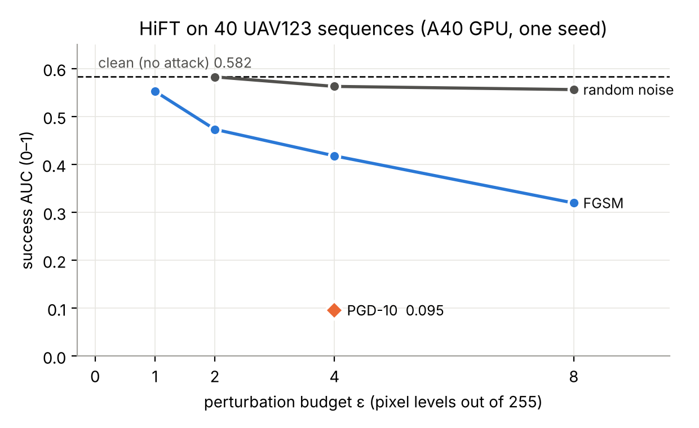
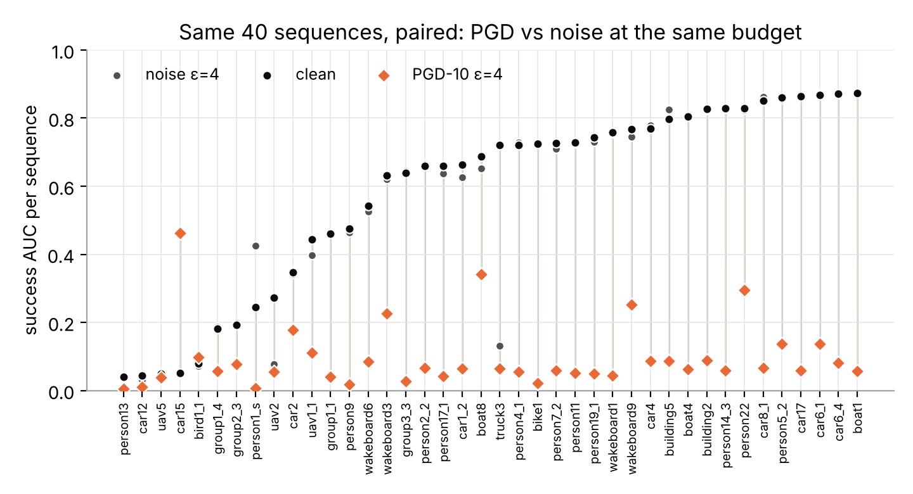
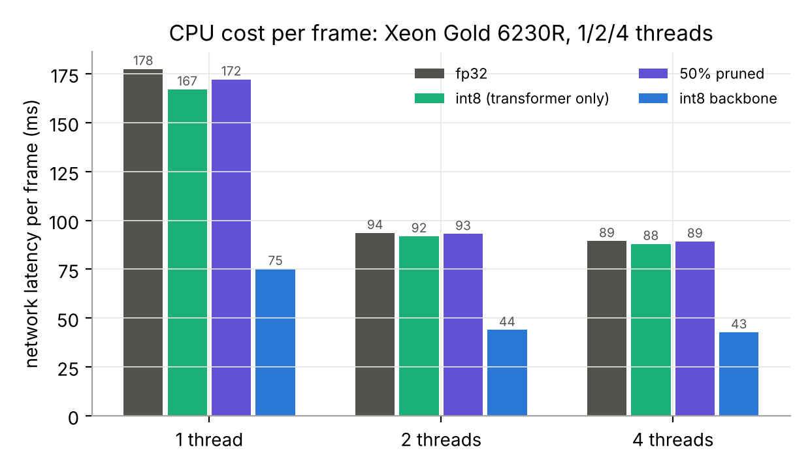

# HiFT stress test: results so far (17 Oct 2026)

**Scope.** This report covers only the completed TC2 runs in `hift-stress-analysis-handoff.zip`.
- Hardware: NVIDIA A40 GPU, Intel Xeon Gold 6230R CPU, torch 2.8.0.
- Model: official HiFT weights.
- Data: UAV123.
- All runs use one seed.
- AUC is an overlap score from 0 to 1, not a percentage accuracy.

## Bottom line
1. **Our setup reproduces HiFT.** Clean success AUC on all 123 UAV123 sequences is **0.584** (GPU) and 0.586 (CPU). The paper reports 0.589.
2. **HiFT is very easy to fool.**
   - On a fixed 40-sequence subset, a 10-step PGD attack that changes each pixel by at most 4 levels out of 255 cuts AUC from **0.582 to 0.095**.
   - Random noise of the same size gives 0.563.
   - The attack lowered AUC by more than 0.05 on 35 of 40 sequences.
3. **The int8 backbone is the only compression that made HiFT faster on CPU.**
   - Network time per frame dropped from 89 ms to 43 ms at 4 threads (2.1× faster), and from 178 ms to 75 ms at 1 thread.
   - The model shrank from 44.3 MB to 33.1 MB.
   - Its tracking accuracy has not been measured yet.

## 1. Validation (done before any conclusion)
| Check | Result |
|---|---|
| Bundle integrity | All 681 files match `file-sha256.json`. |
| Code | Deployed `hiftstress/` and `scripts/` are identical to the shared package. |
| Completeness | All 11 tracking runs have all their sequences. Frame counts match the box files (37,681 for the 40-sequence subset; 112,578 for full UAV123). Each `summary.json` equals the mean of its per-sequence curves. |
| Same 40 sequences | All nine subset runs use the exact list in `attack-subset-40.json`, with identical frame counts. |
| Subset representative | Clean AUC on the subset is 0.582, against 0.584 on all 123 sequences. |
| GPU repeatability | Subset clean matches the full-run clean result on those 40 sequences exactly (difference 0.0000 on every sequence). |
| CPU vs GPU | Mean AUC differs by +0.003. Individual sequences differ by up to 0.19 (person1_s, group3_2), from floating-point differences alone. **Treat single-sequence gaps below about 0.2 as possibly numerical.** |

**Discrepancies to know about:**
- **Precision is 0.754 here vs 0.787 in the paper. This is a scoring rule, not a bug.**
  - HiFT's official toolkit (`toolkit/utils/statistics.py`) counts frames where the target is absent as precision *hits*. Ours counts them as misses.
  - AUC uses the same rule in both, which is why it matches.
  - The rule is applied identically to every one of our runs, so our comparisons stand. Re-score with the official rule before quoting precision next to the paper.
- **The column `fps_end_to_end` in `results/tables` is misnamed.** It excludes image loading. Use the three timing levels in section 3 instead.
- **The `gflops_total` column shows the fp32 count for every variant.** Quantisation and pruning do not change it, so don't read it as a saving.
- **The existing figures in `results/figures` are labelled "flat-40seq"** and mix runs. Use the figures in this report instead.

## 2. Robustness (40 sequences, A40 GPU, fp32, no defence)
| Condition | Success AUC | Precision @20 px | Mean change vs clean (95% range over sequences) | Sequences worse by >0.05 | Change vs noise at same ε |
|---|---|---|---|---|---|
| Clean | 0.582 | 0.754 | — | — | — |
| Noise ε=2 | 0.582 | 0.756 | −0.000 (−0.014, +0.013) | 1/40 | — |
| Noise ε=4 | 0.563 | 0.729 | −0.020 (−0.056, +0.005) | 2/40 | — |
| Noise ε=8 | 0.556 | 0.738 | −0.027 (−0.064, −0.001) | 6/40 | — |
| FGSM ε=1 | 0.552 | 0.772 | −0.030 (−0.084, +0.028) | 20/40 | no noise ε=1 run |
| FGSM ε=2 | 0.473 | 0.709 | −0.110 (−0.175, −0.043) | 25/40 | −0.109 |
| FGSM ε=4 | 0.418 | 0.672 | −0.165 (−0.236, −0.092) | 29/40 | −0.145 |
| FGSM ε=8 | 0.319 | 0.578 | −0.263 (−0.339, −0.186) | 32/40 | −0.237 |
| **PGD-10 ε=4** | **0.095** | **0.323** | **−0.487 (−0.574, −0.395)** | **35/40** | **−0.467** |

The ranges come from resampling the 40 sequences, not frames. They describe spread across sequences; they are not significance tests.

**How to read the paired chart:**
- **PGD breaks almost everything that was working.** Of the 33 sequences HiFT tracks reasonably when clean (clean AUC ≥ 0.2), only 1 keeps half its clean AUC under PGD. Their mean drops from 0.687 to 0.093.
- **The 7 sequences HiFT already fails cleanly** (for example person13, car12, uav5) have little left to lose.
- **No object class was spared.** Mean PGD AUC per class is 0.02 to 0.15 (boats, cars, people, wakeboards, buildings). Several classes have only 1 to 3 sequences, so don't rank them.
- **One sequence is fragile even to plain noise:** truck3 goes from 0.72 clean to 0.13 with noise at ε=4. This is another reason not to over-read single sequences.
- **FGSM ε=1 can't be told apart from clean** in the mean (its range crosses zero). Precision even rises slightly. With no noise ε=1 run, we can't separate it from noise either.

## 3. Speed and size
**There are three different timing numbers. Keep them separate:**
| Level | What it includes | GPU clean (A40) | CPU clean (6230R, 4 threads) | GPU PGD-10 |
|---|---|---|---|---|
| Network only | One forward pass on a fixed crop, after warm-up | 6.5 ms | 89 ms | — |
| Tracking per frame | Crop + network + post-processing + attack; **no image loading** | 10.6 ms (94 fps) | 92 ms (11 fps) | 159 ms (151 ms is the attack) |
| Job wall time | Everything, including reading images | 18.6 ms/frame (11.7 min for 40 seqs; 35.4 min for 123) | 100 ms/frame (188 min for 123) | 164 ms/frame (103 min for 40 seqs) |

**Network cost per variant (CPU, network only, 200 timed repeats):**
| Variant | 1 thread | 2 threads | 4 threads | Backbone / head at 4 threads | Size | Same top location as fp32 (60 real crops) |
|---|---|---|---|---|---|---|
| fp32 | 178 ms | 94 ms | 89 ms | 67 / 23 ms | 44.3 MB | reference |
| int8, transformer Linear layers only | 167 ms | 92 ms | 88 ms | 67 / 21 ms | 37.3 MB | 100% |
| 50% pruned | 172 ms | 93 ms | 89 ms | 66 / 23 ms | 44.3 MB (stored dense) | **55%** |
| **int8 backbone** | **75 ms** | **44 ms** | **43 ms** | **19 / 24 ms** | **33.1 MB** | 93% (56 of 60) |

**What this shows:**
- **Going from 2 to 4 threads barely helps** (94 ms to 89 ms).
- **After int8 on the backbone, the transformer head is more than half the remaining cost.** That makes the head the next target. Dynamic int8 left the attention projections in fp32, so it gained nothing.
- **Pruning removes weights but not time,** because dense hardware still does every multiply. It also moved the target peak on 45% of crops, which is an accuracy risk.
- **The 33.1 MB vs 44.3 MB size gap is real.** But "same top location on 93% of crops" is a proxy, not tracking accuracy. The int8 tracking accuracy run has not been done. The one-sequence CPU probe is not evidence.

## 4. Conclusions the data supports
1. The pipeline is sound and reproduces HiFT's published AUC on UAV123 to within 0.005.
2. HiFT is highly vulnerable to small, digital, white-box perturbations of its search crop. PGD at ε=4 removes most of its tracking ability on 35 of 40 sequences, while same-size random noise barely matters.
3. Damage grows steadily with the FGSM budget (0.55, 0.47, 0.42, 0.32 for ε = 1, 2, 4, 8). An iterative attack is far stronger than a single step at the same budget.
4. On CPU, int8 quantisation of the backbone roughly halves network time and cuts model size by a quarter. Dynamic int8 and unstructured pruning give no speed-up.

## 5. Limitations
- One seed. PGD has a random start, and the per-sequence CPU/GPU gaps show the tracker is sensitive to tiny numerical changes.
- PGD was run at only one budget (ε=4). There's no noise ε=1 run.
- The threat model is digital and white-box: the attacker changes the crop the network sees each frame and knows the weights. That is not a physical attack, and the 151 ms per frame attack cost makes it an offline upper bound.
- All results are on UAV123 benchmark video, with no flight tests and no real onboard hardware. The Xeon CPU is a stand-in, not a drone computer.
- No defence, adaptive attack, GPU compression or int8 tracking-accuracy result exists yet.

## 6. Where to head next (proposed; none of this has been run)
Route 2 asks us to **propose a change and test it**. So far we have shown the weakness, but not yet tested a fix.

| Priority | Experiment | Why | Estimated cost (from measured times) |
|---|---|---|---|
| 1 | Re-score existing predictions with the official HiFT toolkit rule | Paper-comparable precision; no tracking needed | Minutes on CPU (needs the UAV123 annotation files) |
| 2 | **Phase B defences** on the same 40 sequences at ε=4: blur, median, bit-depth, JPEG × {clean, PGD, adaptive PGD} | This is our proposed improvement. It answers how much robustness each defence buys, what it costs on clean tracking, and whether it survives an attacker who knows about it | About 3.7 h per defence → split over 3–4 GPU jobs |
| 3 | **int8-backbone tracking accuracy** on the 40 sequences (CPU) | Turns the 2.1× speed-up into a full speed-vs-accuracy result | About 1 CPU job |
| 4 | PGD at ε = 1, 2, 8, plus PGD ε=4 with seeds 1 and 2 | Completes the curve and shows how stable the headline is | About 1.7 h each → 3 GPU jobs |
| 5 | Compressed models under attack (Phase C) | Is the faster model easier to fool? | fp16/pruned on GPU: about 1.7 h each. Int8 on CPU needs about 20 h at the measured 0.5 fps, so split by sequence, or compute perturbations on the GPU and replay them (code change) |
| 6 | GPU edge part: fp16, compile, prune accuracy | GPU latency side of the edge story | About 1 GPU job |

**Suggested order with TC2's two-job limit:** 1 and 3 can run together first. Then run 2, which is the core result for the report. Then 4, 5 and 6 as time allows.

*Sources:* HiFT paper (Cao et al., ICCV 2021, [arXiv:2108.00202](https://arxiv.org/abs/2108.00202), Table 1: UAV123 precision 0.787, success 0.589). Scoring rule from HiFT's toolkit, `toolkit/utils/statistics.py` at commit `992aa7c`.
