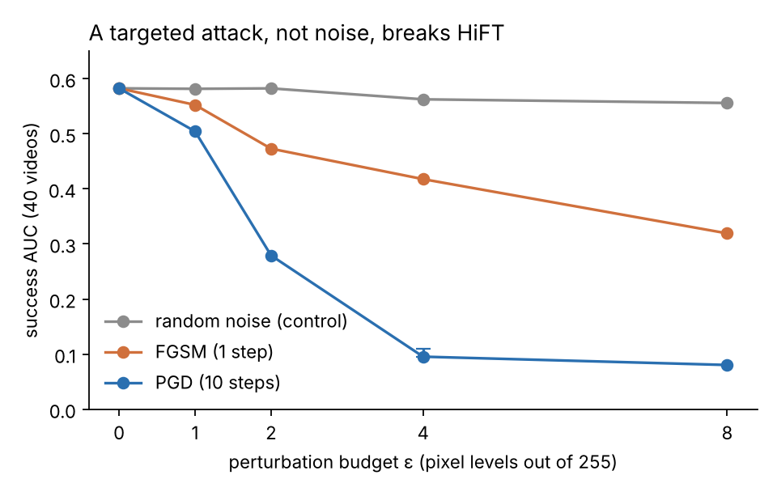
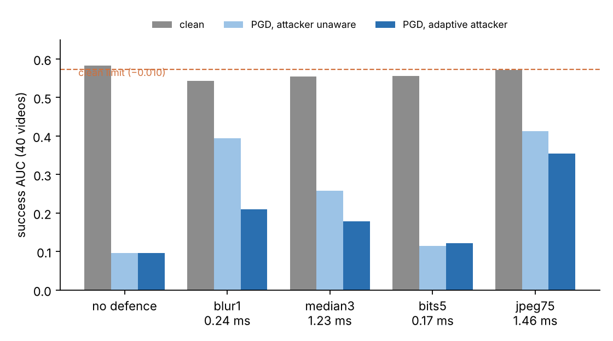
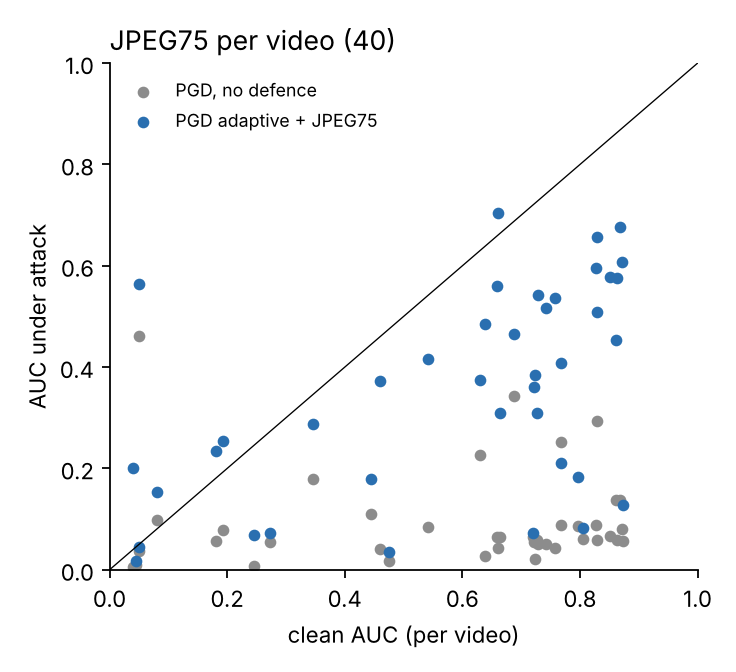
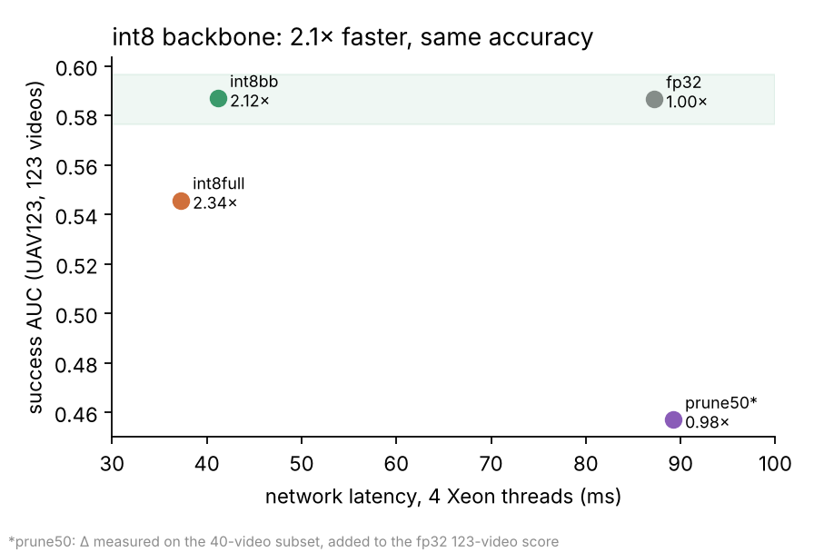

# HiFT stress test, round 2: where we stand (19 Oct 2026)

Scope: Manzi's tracks (adversarial robustness + edge cost). All 10 round-2 queues are complete: 38 tracking runs plus CPU cost benchmarks.

- **Pass rules:** fixed before any round-2 result existed. See [`EXPERIMENT_PLAN.md`](../../EXPERIMENT_PLAN.md).
- **Raw scorecard:** [`criteria_final.md`](criteria_final.md).
- **Numbers in this report:** recomputed independently from the per-video files by [`analyse.py`](analyse.py). The output is in [`analyse_output.txt`](analyse_output.txt) and [`numbers.json`](numbers.json).

## 1. Bottom line

**Goal recap.** HiFT claims to be "efficient and effective" for aerial tracking. We judge any change against HiFT's own numbers:

| Paper claim | Value | Our yardstick |
|---|---|---|
| Lead over SiamRPN++ on UAV123 | 0.589 vs 0.579 success (+0.010) | Allowed accuracy loss: 0.010 |
| Speed on the drone board (AGX Xavier) | 31.2 FPS, just above real time | Allowed time overhead: 3.85% |

**No change passed every pre-registered rule.** Two came close, and both are worth reporting as improvements with clearly stated trade-offs:

1. **JPEG-75 input filter (robustness).**
   - HiFT under attack recovers from 0.095 to **0.355** success, against an attacker who knows about the filter. That is **53% of the lost score**.
   - Without the filter, none of the 30 videos the attack breaks keeps even half of its clean score. With it, 20 do.
   - **Cost:** −0.012 clean success, just over the 0.010 limit. 38 of 40 videos are unaffected; the whole cost comes from 2 videos.
   - **Time:** 1.46 ms per frame, which is 13.7% of our very fast A40 frame time.
2. **int8 backbone (efficiency).**
   - The network runs **2.1× faster** on CPU (87.2 → 41.2 ms) and the model is 25% smaller (44.3 → 33.1 MB).
   - On the full UAV123 benchmark, success is **unchanged**: 0.587 vs 0.586. Official precision is 0.784, against 0.787 in the paper.
   - It formally missed the rule on the 40-video subset (−0.0125 vs −0.010). That gap is about the size of the effect of changing which videos are used to calibrate int8.

**What we can claim:**
- HiFT is badly exposed to small, invisible attacks. Success drops from 0.58 to 0.10 at ε = 4/255, and the result is stable over 3 seeds.
- A cheap, training-free filter recovers half of that loss at a small clean cost.
- Converting the backbone to int8 halves network time with no loss of accuracy on the full benchmark.

**What we cannot claim yet:**
- That JPEG survives a *stronger* adaptive attacker. Ours was 10 steps with a straight-through gradient (BPDA).
- Any speed on drone hardware.
- That the two changes work together.

Section 6 lists what would make each claim conclusive, with run times.

## 2. Evidence validation (what was checked)

| Check | Result |
|---|---|
| File integrity | 2071 / 2071 SHA-256 hashes match |
| Deployed source vs our repo | Identical: all `hiftstress/`, `scripts/`, `slurm/` and queue files |
| Completeness, per run | Every 40-video run has exactly the fixed list, 37,681 frames and 40 box files. Every 123-video run has 112,578 frames and 123 box files |
| Settings vs run name, per run | Attack, ε, steps, adaptive flag, defence, device and seed all match. No problems |
| Summary vs per-video data | Each summary AUC equals the mean of its per-video AUCs |
| Scorer vs independent recomputation | All deltas and intervals reproduce to 4 decimals |
| Re-scoring from saved boxes | 11 / 11 reproduce, largest gap 6.7e-6 (box rounding) |
| int8 calibration leakage | 40-video runs: 0 calibration videos in the test set. 123-video runs: 20 calibration videos inside the test set. Removing them does not change the result (int8bb +0.0028) |
| Hardware mix | Queue 07 ran on an L40S, so its times are lower. Speed comparisons below use matched runs only |

## 3. Findings

### 3.1 Reproduction of the paper (clean, all 123 UAV123 videos)

| | Success AUC | Precision@20 (HiFT's official rule) |
|---|---|---|
| HiFT paper | 0.589 | 0.787 |
| Ours, GPU | 0.584 | 0.780 |
| Ours, CPU fp32 | 0.586 | 0.783 |

- Our runs are within 0.005 success and 0.007 precision of the paper, so the baseline is reproduced.
- Our earlier 0.754 precision used a strict rule that counts frames where the target is absent as misses. The paper's toolkit counts them as hits.

### 3.2 Vulnerability: an invisible attack breaks HiFT ([fig 1](fig1_attack_curve.png))



All results are on the fixed 40 videos; clean success is 0.582.

| ε (pixel levels out of 255) | Random noise | FGSM (1 step) | PGD (10 steps) |
|---|---|---|---|
| 1 | 0.582 | 0.552 | 0.504 |
| 2 | 0.582 | 0.473 | 0.279 |
| 4 | 0.563 | 0.418 | **0.095** |
| 8 | 0.556 | 0.319 | 0.080 |

- **The damage comes from targeting, not noise.** Noise of the same size barely moves success, even at ε = 8.
- **PGD at ε = 4 is stable:** mean 0.102, SD 0.007 over 3 seeds. Under it, 35 of 40 videos get worse, by −0.487 [−0.574, −0.392].
- **Ours is stronger than published attacks on HiFT.** Ad²Attack (ICRA 2022) cut HiFT's success by 51% averaged over benchmarks; ours cuts it by 84%. Ours is white-box, so it is the stronger threat model.

### 3.3 Defences ([fig 2](fig2_defences.png), [fig 3](fig3_jpeg_per_video.png))



Changes are paired by video, with 95% bootstrap intervals. "Recovered" is the share of the 0.487 lost to PGD that the defence wins back against the adaptive attacker.

| Defence | Clean change | Gain, attacker unaware | Gain, adaptive attacker | Recovered | Defence time |
|---|---|---|---|---|---|
| blur σ=1 | −0.040 [−0.078, −0.011] | +0.299 | +0.114 [+0.072, +0.159] | 23% | 0.24 ms (2.3%) |
| median 3×3 | −0.027 [−0.064, −0.002] | +0.163 | +0.083 [+0.050, +0.122] | 17% | 1.23 ms (11.6%) |
| 5-bit depth | −0.026 [−0.062, −0.001] | +0.018 | +0.027 [+0.010, +0.049] | 5% | 0.17 ms (1.6%) |
| **JPEG q75** | **−0.012 [−0.029, +0.000]** | **+0.317** | **+0.259 [+0.200, +0.320]** | **53%** | 1.46 ms (13.7%) |

**What this shows:**
- **Adaptive attackers erase most of the apparent gain.** Blur falls from +0.299 to +0.114 once the attacker knows it is there. This is the pattern Athalye et al. (2018) predict, and the reason we judge on the adaptive column.
- **JPEG holds up best:** it loses only 0.058 against the adaptive attacker and is the only defence whose clean interval reaches 0.
  - **The clean cost sits in 2 videos.** `uav2` and `wakeboard6` each lose 0.227; the other 38 change by at most ±0.01. This is reported, not used to exclude them.
  - **It rescues most of the broken videos.** Of the 30 videos PGD breaks, JPEG keeps at least half the clean score on **20**. For comparison: blur 9, median 6, bits 3, no defence 0.
- **Every defence fails at least one rule:**
  - Blur and median cost 3–4× the allowed clean loss.
  - Bit-depth barely helps.
  - JPEG misses the clean limit by 0.0016, with an interval that includes passing, and misses the time limit.



**Against published defences, JPEG is a much cheaper trade-off.** Trained defences recover more, but at a price:

| Defence | Recovery | Price |
|---|---|---|
| Pluggable U-Net purifier, on SiamRPN++ | 0.373 → 0.555 | Jetson speed 40 → 12 FPS |
| CMDN | | Up to 7.3% clean success |
| **JPEG q75 (ours, HiFT)** | 0.095 → 0.355 against an *adaptive* attacker | About 1–2% clean, 1.5 ms per frame, no training |

### 3.4 Compression ([fig 4](fig4_compression.png))



All comparisons are against fp32 on the same CPU.

| Variant | Network ms (4 threads) | Speed-up | Size | Change, 123 videos | Change, 40 videos |
|---|---|---|---|---|---|
| fp32 | 87.2 | 1.00× | 44.3 MB | (reference 0.586) | (0.588) |
| **int8bb** (int8 backbone) | **41.2** | **2.12×** | 33.1 MB | **+0.000 [−0.009, +0.011]**, 2 videos better / 4 worse | −0.012 [−0.028, −0.001] |
| int8full (+ head) | 37.2 | 2.34× | 21.8 MB | −0.041 [−0.064, −0.018], 22 videos worse | −0.069 |
| prune50 | 89.2 | 0.98× | 44.3 MB | not run | −0.130 |
| int8dyn | 88.0 | 0.99× | 37.3 MB | not run | not run |

- **int8bb gives a real 2× speed-up for free on the full benchmark.**
  - The calibration-overlap check: excluding the 20 calibration videos gives +0.003.
  - **Its 40-video miss looks like calibration sensitivity.** Two int8bb models calibrated on different video sets differ by −0.005 [−0.017, +0.004] on the same 40 videos.
- **Converting the head to int8 is not worth it:** it adds only 10% more speed and costs 0.04 success.
- **Pruning gives no speed:** removing weights without changing the layer shapes saves no computation on a CPU.
- **Compression does not change attack vulnerability.** PGD computed on the fp32 model transfers fully:

  | Model under PGD | Success | vs fp32 under PGD (0.095) |
  |---|---|---|
  | int8bb | 0.101 | +0.006 [−0.005, +0.019] |
  | int8full | 0.097 | +0.002 |

## 4. Scorecard against the pre-registered rules

| Proposed improvement | Rule 1 | Rule 2 | Rule 3 | Verdict |
|---|---|---|---|---|
| JPEG q75 | Adaptive gain +0.259 ≥ 0.10 ✅ | Clean −0.0116 vs −0.010 ❌ (narrow; interval includes passing) | Overhead 13.7% vs 3.85% ❌ | Robust but costly |
| blur σ=1 | +0.114 ✅ | −0.040 ❌ | 2.3% ✅ | Robust but costly |
| median 3×3 | +0.083 ❌ | −0.027 ❌ | 11.6% ❌ | Partial gain |
| 5-bit depth | +0.027 ❌ | −0.026 ❌ | 1.6% ✅ | Partial gain |
| int8bb | 2.12× ✅ | 40 videos: −0.0125 ❌ (narrow). 123 videos: +0.0004 ✅ | – | Faster; accuracy rule missed on the subset only |
| int8full | 2.34× ✅ | −0.069 / −0.041 ❌ | – | Faster but less accurate |
| prune50 | 0.98× ❌ | −0.130 ❌ | – | No gain |

## 5. Limitations (state these in the group report)

1. **The adaptive attack is moderate:** 10 PGD steps at ε = 4, with a straight-through gradient (BPDA) through JPEG, median and bit-depth, and no averaging over random transforms (EOT). Stronger attacks usually lower such defences further. So **0.355 is an upper bound** on JPEG's robustness.
2. **The time overhead is measured on an A40 GPU,** where one frame takes only 10.6 ms. JPEG runs on the CPU through OpenCV. Its 1.46 ms would be about 4.6% of HiFT's 32 ms Xavier frame, but only if the Xavier ran it equally fast, which was not measured.
3. **The CPU speed-ups are on a Xeon, not on drone hardware.** The paper's 31.2 FPS is on the Xavier's GPU, where int8 needs TensorRT. Our 2.1× applies to CPU-class boards and does not transfer to the Xavier GPU without measuring it.
4. **Scope:**
   - One weight file.
   - One attack seed per defence (attack stability was shown separately: SD 0.007).
   - One calibration set per int8 run.
   - Attacks on the 40-video subset only. That subset is representative: clean 0.582 vs 0.584 on all 123.
5. **Per-attribute results** (occlusion, fast motion and so on) exist only for round-1 runs. The attribute labels file was not in the package.
6. **The defences are image filters, not model changes.** They do not make HiFT itself more robust; adversarial training would, but needs HiFT's training data, which is out of scope.

## 6. What would make the improvement conclusive (proposed, NOT run)

Ordered by value per GPU-hour. Times are from measured round-2 rates: JPEG adaptive takes 168 ms/frame, so 1.8 h per 40-video run.

| # | Test | Why | Cost | Decides |
|---|---|---|---|---|
| 1 | **Stronger adaptive attack on JPEG:** 50-step BPDA plus a differentiable-JPEG approximation, with EOT | Makes the 53% recovery credible, or shows it collapses (Athalye 2018) | About 9 h GPU, in 2 jobs | Whether JPEG is a real robustness gain |
| 2 | **JPEG quality sweep (q85, q90, q95):** choose the quality on the *other* 83 videos, then test once on the fixed 40 | A higher quality should cut the clean cost below 0.010 while keeping most of the robustness. Choosing on separate videos avoids tuning to the test set | About 6 h GPU | A single setting that passes both accuracy rules |
| 3 | **JPEG on the GPU** (`torchvision.io.encode_jpeg` / nvJPEG), timed per frame | Removes the CPU round-trip; may bring the overhead under 3.85% | Under 1 h | The time rule |
| 4 | **int8bb with 3 calibration sets** on the fixed 40 | Turns "probably calibration noise" into a measured spread | About 1.5 h CPU | Whether the 40-video miss is real |
| 5 | **Combined int8bb + JPEG** on CPU: clean, plus adaptive PGD from a GPU attacker | The "efficient and robust HiFT" configuration in one table | About 2.5 h | The headline claim |
| 6 | **Natural corruptions** (UAV-C noise and blur) with JPEG and int8bb | Robustness that matters even without an attacker; links to UAV-C's HiFT numbers | About 2 h | A broader robustness claim |

If tests 1, 2 and 5 hold, the group can claim: **"a training-free change that halves HiFT's network time and recovers about half of its attack loss, at no more clean cost than HiFT's own lead over SiamRPN++."** That is a meaningful improvement on the paper's own efficient-and-effective terms.

## Files

- `REPORT.md`: this report.
- `fig1`–`fig4`: the four figures.
- `analyse.py`: recomputes every number and figure from the results folder.
- `validate.py`: the completeness and settings checks.
- `numbers.json`: every number in this report.
- `criteria_final.md`: the scorer output from TC2.

Re-run:

```bash
python validate.py <results> runs.json
python analyse.py <results> <outdir>
```

(Both expect the package layout, with `source/attack-subset-40.json` next to `results/`.)
