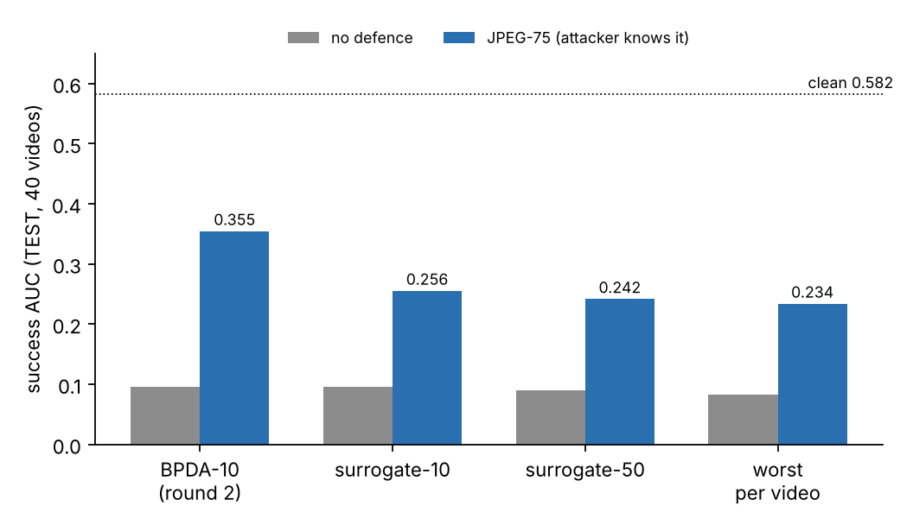
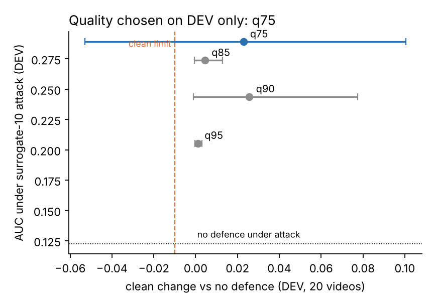
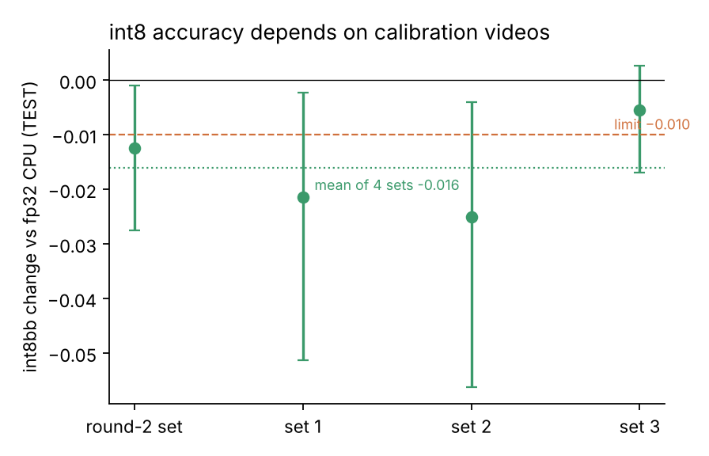

# HiFT stress test, round 3: final results and where the project stands (21 Oct 2026)

Scope: Sandhy's tracks (adversarial robustness + edge cost).

This was a shortened round 3. Every required stage-1 job ran, plus the CPU stage-2 job. The remaining tests were stopped under the user-approved rule "stop a claim once a required gate has definitively failed" (section 5).

- **Rules:** [`ROUND3_PLAN.md`](../../ROUND3_PLAN.md), fixed before any round-3 result existed.
- **Scorecard:** [`criteria_round3_final.md`](criteria_round3_final.md), unchanged.
- **Numbers in this report:** recomputed independently from per-video files by [`analyse3.py`](analyse3.py). The output is in [`analyse3_output.txt`](analyse3_output.txt) and [`numbers3.json`](numbers3.json).

## 1. Bottom line

**Verdicts:**
- **Claim R** (robust HiFT on GPU): not met.
- **Claim E+R** (efficient and robust HiFT on CPU): not met.

Neither is "not run"; both fail a fixed accuracy rule.

**What round 3 established:**

1. **The JPEG filter is a real robustness gain against strong adaptive attackers. Rule H6 passed.**
   - We attacked it with a gradient that goes *through* a differentiable copy of JPEG, for 50 steps.
   - The worst case per video went from 0.083 without the filter to **0.234** with it: **+0.151 [+0.108, +0.198]**. 26 videos improved; none got worse.
   - The round-2 figure (0.355) was optimistic; the honest figure is about 0.24. It is still clearly above zero and above the +0.10 bar.
2. **JPEG's clean cost on the test videos is −0.012, just over the −0.010 limit (rule H7 fails).**
   - The interval [−0.029, +0.000] includes passing. As in round 2, the cost sits in 2 videos.
   - On the 20 held-out DEV videos, the same filter *improved* clean tracking (+0.023).
3. **int8 backbone accuracy depends on which videos are used for calibration (rule H9 fails).**
   - It is still 2.1× faster.
   - Four calibration sets gave changes from −0.005 to −0.025; the mean is **−0.016** (limit −0.010).
   - The round-2 result (0.000 on all 123 videos) was one of the luckier draws.
4. **int8 + JPEG on CPU:** 2.05× faster (passes); the JPEG overhead of 3.1% fits HiFT's real-time margin (passes); clean change −0.017 (fails).
   - Almost all of that loss comes from int8. Adding JPEG to the same int8 model costs only −0.004 [−0.019, +0.005].

**What the group can say about improving HiFT:**
- A training-free input filter makes HiFT substantially more robust to adaptive pixel attacks: 30% of the loss recovered against the strongest attacker tested.
- **Price:**
  - about 1% clean success on the test videos (just over the strict budget we set, which is HiFT's own lead over SiamRPN++);
  - 1.4 ms per frame, which is 3.1% of CPU-class tracking time but 13.7% on a fast desktop GPU.
- Post-training int8 doubles speed but is not reliably within the accuracy budget.
- So we found **a robustness improvement with a measured trade-off**, not a free improvement.

## 2. Evidence validation

| Check | Result |
|---|---|
| File integrity | 2,908 / 2,908 SHA-256 hashes match |
| Deployed code vs our repo | Identical: every `hiftstress/`, `scripts/`, `plan/` and `slurm/` file |
| Completeness, all 21 round-3 runs | Every TEST run: exactly the fixed 40 videos, 37,681 frames, 40 box files. Every DEV run: exactly the 20 DEV videos, 16,826 frames. No problems |
| Settings | 50-step runs have 50 steps; surrogate runs use `grad=diff`; "selected" runs used jpeg75; calibration runs record their set number |
| DEV / TEST separation | No video is in both. No calibration video is in TEST; sets 1–3 drew 3–7 videos that are also in DEV, which is harmless because DEV only chooses the JPEG quality |
| Selection | Made by the script from DEV only, never edited by hand. All four qualities were eligible; q75 had the highest DEV robustness |
| Scorer | Every number in `criteria_round3_final.md` reproduces to 4 decimals |
| Linked runs | Because q75 was chosen, the "selected" runs link to the identical JPEG-75 runs. They are the same experiment, not new evidence |

## 3. Findings

### 3.1 JPEG-75 against stronger adaptive attackers ([fig 5](fig5_jpeg_vs_stronger_attacks.png))



All on TEST, ε = 4/255. Clean success is 0.582.

| Attacker | No defence | JPEG-75, attacker knows it | Gain |
|---|---|---|---|
| BPDA, 10 steps (round 2) | 0.095 | 0.355 | +0.259 [+0.200, +0.320] |
| Surrogate gradient, 10 steps | 0.095 | 0.256 | +0.160 [+0.113, +0.211] |
| Surrogate gradient, 50 steps | 0.090 | 0.242 | +0.152 [+0.108, +0.198] |
| **Worst per video** | **0.083** | **0.234** | **+0.151 [+0.108, +0.198]** (26 better / 0 worse) |

**What changed the result was the gradient, not the step count:**
- The surrogate gradient lowers JPEG's score by −0.099 [−0.140, −0.065] compared with BPDA.
- 50 steps instead of 10 adds only −0.014 [−0.029, +0.004].
- Without a defence, PGD-50 is no stronger than PGD-10 (−0.006, interval includes 0).

So the attacks have converged, and **0.23–0.24 is a credible robustness level for JPEG-75** under this threat model. This is what Athalye et al. (2018) predict for input-transform defences: part of round 2's apparent robustness was the weak attack, but a real gain remains.

**Videos rescued:** of the 30 videos the attack breaks, JPEG keeps at least half the clean score on **10** under the worst case. That compares with 20 under round 2's weaker attack and 0 without a defence. Overall it recovers **30%** of the lost score (53% against BPDA-10).

### 3.2 Choosing the quality on DEV, then the clean cost on TEST ([fig 6](fig6_dev_quality_sweep.png))



On the 20 DEV videos, never used for testing (no defence: clean 0.594; under attack 0.123):

| Quality | Clean change | Under surrogate-10 attack (gain) |
|---|---|---|
| 75 | +0.023 [−0.053, +0.101] | 0.289 (+0.167) |
| 85 | +0.004 [−0.001, +0.013] | 0.274 (+0.151) |
| 90 | +0.026 [−0.001, +0.077] | 0.244 (+0.121) |
| 95 | +0.001 [−0.000, +0.003] | 0.205 (+0.083) |

- **Lower quality means stronger filtering and more robustness.** All four qualities were within the clean limit on DEV, so the rule picked the most robust one, q75.
- **On TEST, q75 costs −0.0116** [−0.029, +0.000], 2 videos worse. That fails H7 by 0.0016.
- Pooling DEV and TEST (60 videos) gives −0.000 [−0.029, +0.031]. This pooling is descriptive only; the rule judges TEST.
- **q85 is a pointer for future work, not a result:** on DEV it was almost as robust as q75 (0.274 vs 0.289) with a much tighter clean interval. It was never tested on TEST, because that queue was skipped.

### 3.3 int8 calibration spread ([fig 7](fig7_int8_calibration.png))



Change vs fp32 on the same CPU, on TEST:

| Calibration set (20 videos, 2 frames each) | Success | Change |
|---|---|---|
| Round-2 set | 0.576 | −0.012 [−0.028, −0.001] |
| Set 1 | 0.567 | −0.021 [−0.051, −0.002] |
| Set 2 | 0.563 | −0.025 [−0.056, −0.004] |
| Set 3 | 0.583 | −0.005 [−0.017, +0.003] |
| **Mean of 4** | | **−0.016**, SD 0.009 |

- **The spread comes from a few videos.** In 5 videos the calibration sets disagree by more than 0.05; on `car4` they disagree by 0.50. Plain post-training int8 with a small calibration set is therefore fragile for HiFT, although the speed gain (2.1×) is solid.
- **The round-2 "0.000 on all 123 videos" used the round-2 calibration set** (the best but one), with in-sample calibration videos. It should now be reported as one draw, not a guarantee.

### 3.4 Costs (measured)

| Measurement | Value |
|---|---|
| JPEG-75 time per frame, inside tracking | A40 GPU: 1.46 ms = **13.7%** of a 10.6 ms tracking step (fails H8). CPU next to int8 at 4 threads: 1.40 ms = **3.1%** of a 45.0 ms tracking step (passes H8) |
| Network latency, 4 Xeon threads | fp32 87.2 ms. int8bb 41.2 ms. int8bb + JPEG 42.6 ms → **2.05×** (passes H10 speed) |
| JPEG done on the GPU (benchmark only) | 1.33 ms, against 1.39 ms for OpenCV on the same A40. **No real saving.** The tracking runs that would formally test this were not run, so H8 for GPU JPEG is unmeasured; the benchmark suggests it would also miss |

## 4. Where the whole project stands (rounds 1–3)

| Question | Answer | Evidence |
|---|---|---|
| Does our setup reproduce the paper? | Yes. Success 0.584 / precision 0.780 against the paper's 0.589 / 0.787 | All 123 UAV123 videos |
| Is HiFT vulnerable? | Severely. 0.582 → 0.083 worst case at ε = 4/255; random noise of the same size costs ~0.02 | Rounds 1–3, stable over 3 seeds |
| Does a cheap defence help against an attacker who knows about it? | **Yes. JPEG-75: +0.151 [+0.108, +0.198] under the strongest attack we tried** | Round 3, H6 pass |
| Is it free? | No. −0.012 clean on TEST (limit −0.010), and 1.4 ms per frame | H7 fail; H8 GPU fail, CPU pass |
| Is int8 a free speed-up? | 2.1× faster, but accuracy −0.005 to −0.025 depending on calibration | H9 fail |
| Blur / median / bit-depth? | Weaker: each costs 0.026–0.040 clean | Round 2 |

**Compared with published work:**

| Work | Recovery | Price |
|---|---|---|
| U-Net purifier on SiamRPN++ (trained) | 0.373 → 0.555 against a non-adaptive attack | Jetson speed 40 → 12 FPS |
| CMDN (trained) | | Up to 7.3% clean success |
| **JPEG-75 (ours, no training)** | 30% of the loss, against an *adaptive* attacker | About 2% clean (−0.012 of 0.582), 1.4 ms per frame |

JPEG-75 sits at the cheap end of that trade-off and is tested to a stricter standard.

## 5. What was not run, and why

The user approved skipping optional work and stopping claims that had already failed.

| Not run | Why |
|---|---|
| Queues 8, 9 (BPDA-50 on JPEG-75) and 17 (other qualities on TEST, plus seeds) | Optional; skipped by the user |
| Queues 12 (rest) and 13 (GPU JPEG tracking runs) | Claim R had already failed H7 |
| Queue 14 (int8 + JPEG under attack) | Claim E+R had already failed H9 and H10-clean. **The combined model's robustness is unmeasured** |
| Queue 16 (natural corruptions) | Deferred with the GPU branch. **No corruption result exists** |

Queues 10 and 11 needed no new runs: they are identical to existing JPEG-75 runs and are linked to them.

## 6. Limitations

1. **One weight file and one ε (4/255);** white-box pixel attacks on the search crop only. These are not physical-world or drone-hardware results.
2. **Time is measured on an A40 and a Xeon,** not a Jetson Xavier.
3. **The DEV set has only 20 videos.** The q75 choice was noisy (its DEV clean interval spans ±0.08).
4. **Attacks on int8 used an fp32 attacker** (round 2); the int8 + JPEG model was not attacked in round 3.
5. **Single seed per round-3 attack run.** Attack stability rests on the round-2 seeds (SD 0.007).

## 7. Possible next steps (proposed, not run; each needs approval)

| # | Test | Why | Cost (measured rates) |
|---|---|---|---|
| 1 | **JPEG-85 on TEST:** clean, plus surrogate-50 | The best DEV trade-off. **This would be a new, separately pre-registered test,** because we have now seen TEST results for q75 | About 9 h GPU |
| 2 | **Better int8 calibration** (100 videos × 4 frames, histogram/percentile observers) or quantisation-aware fine-tuning | Targets the calibration fragility that failed H9 | About 1.5 h CPU per variant; fine-tuning needs training data |
| 3 | **int8 + JPEG under attack** (queue 14 as packed) | Completes the robustness picture for the CPU configuration | About 5 h |
| 4 | **Natural corruptions** (queue 16) | Checks the filter does no harm without an attacker | About 2.5 h GPU |
| 5 | **Randomised JPEG** (quality drawn per frame) | Randomisation makes the attacker's gradient less reliable. Must be tested with EOT (averaging over the randomness) to be credible | About 10 h GPU |

## Files

- `REPORT.md`: this report.
- `fig5`–`fig7`: the three figures.
- `analyse3.py`: recomputes every number and figure from the package's `results/` folder.
- `numbers3.json`: every number in this report.
- `criteria_round3_final.md`: the scorer output from TC2.
- `selected.json`: the official DEV-only choice.

Re-run:

```bash
python analyse3.py <package>/results <outdir>
```
