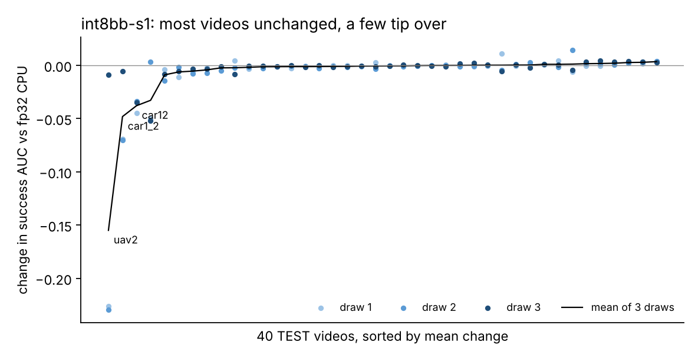
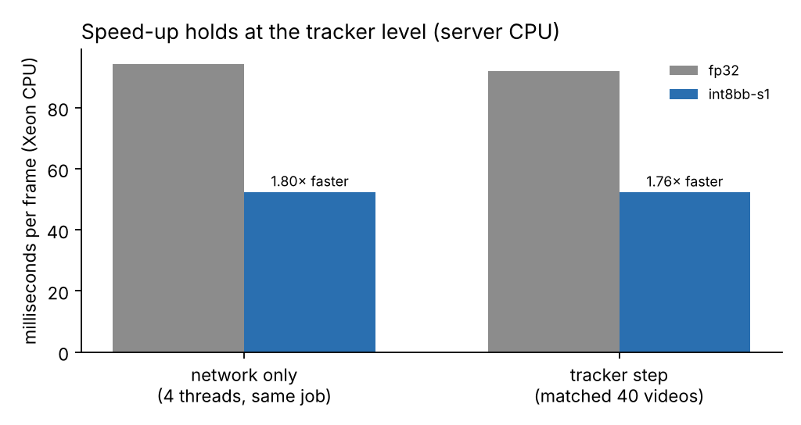

# HiFT stress test, round 4: what we can defend, and where to go next (21 Oct 2026)

Scope: Sandhy's tracks (adversarial robustness + edge cost).

- **Pass rules:** [`ROUND4_PLAN.md`](../../ROUND4_PLAN.md), fixed in advance.
- **Scorecard:** [`criteria_round4_final.md`](criteria_round4_final.md).
- **Numbers in this report:** recomputed independently by [`analyse4.py`](analyse4.py) from per-video files. The output is in [`analyse4_output.txt`](analyse4_output.txt) and [`numbers4.json`](numbers4.json).

## 1. The short version (for the team)

**One improvement passed our rule: a compressed (int8) version of HiFT that runs about 1.8× faster on a server CPU.**
- It keeps HiFT's first layer in full precision.
- Its tracking accuracy is slightly lower: on average −0.007 success on our 40 test videos, against an allowed −0.010.
- On most videos (36 of 40, within ±0.02) nothing changes. The average loss comes almost entirely from **one small, fast, often-hidden target (`uav2`)** that the compressed model loses in two of three calibration draws.
- **What this does not show:** that accuracy is *equivalent*. The uncertainty range still reaches about −0.019, and roughly a 1-in-4 chance remains that the true loss is bigger than 0.010.

**The JPEG filter did not become deployable.**
- It still clearly protects against attacks (round 3).
- But on normal videos, JPEG-75 cost −0.012 and JPEG-85 cost −0.030. Both are over the 0.010 limit, for the same reason: a couple of fragile videos tip over.
- Our 20-video DEV set did not predict which quality would be safe on the test set.

**Recommendation:** run one cheap, CPU-only confirmation (about 4 hours, no GPU), then write up.
- **Main claim:** "faster on CPU with a small, measured accuracy cost."
- **Second finding:** "JPEG protection works, but its normal-video cost could not be shown to be acceptable."

## 2. Evidence table

All values are success AUC on the fixed 40 TEST videos unless stated. Changes are paired by video, with 95% bootstrap intervals over videos.

| Question | Result | What it supports |
|---|---|---|
| fp32 reference, CPU / GPU | 0.588 / 0.582 | Baseline. Paper: 0.589 on all 123 videos |
| **int8bb-s1, 3 calibration draws** | 0.578 / 0.579 / 0.585 | |
| Change vs fp32 CPU, per draw | −0.010 [−0.024, −0.001]; −0.009 [−0.023, −0.001]; −0.003 [−0.007, −0.001] | Every draw is slightly worse; the size depends on the draw |
| **Mean over draws (the rule)** | **−0.0074**, SD 0.0037 → **passes ≥ −0.010** | The pre-registered rule is met |
| Uncertainty, videos and draws resampled | 95% interval [−0.019, −0.001]; chance the loss is beyond −0.010 ≈ 23% | **Equivalence is not established** |
| Median video change / videos within ±0.02 | −0.001 / 36 of 40 | The typical video is unaffected |
| Largest loss | `uav2`: −0.226, −0.230, −0.009 (draws 1/2/3) | One small target drives the average |
| Official precision@20 (HiFT's rule) | 0.785 → 0.773 (−0.013 [−0.029, −0.002]) | Precision drops a little more than success |
| Old recipe (round 3, 4 draws) | Mean −0.016, SD 0.009 | The new recipe roughly **halves** both the loss and its spread |
| Network speed, 4 Xeon threads (same job) | 94.4 → 52.3 ms (**1.80×**); 1 thread **1.92×** | Measured network speed-up |
| Tracker step, matched 40 videos | 91.9 → 52.2 ms per frame (**1.76×**), i.e. 10.9 → 19 fps | Holds at the tracker level (no image loading) |
| Model size | 44.3 → 33.2 MB (−25%) | |
| JPEG-75 / JPEG-85, clean on TEST | −0.012 [−0.029, +0.000] / −0.030 [−0.071, −0.002] | Both fail the normal-video limit |
| JPEG-75 against strong attacks (round 3) | Worst case 0.083 → 0.234: **+0.151 [+0.108, +0.198]** | Protection is real |

## 3. What the accuracy results mean

**Tracking AUC in plain language.** For every frame, we measure how much the tracker's box overlaps the true box (0 = missed entirely, 1 = perfect). "Success AUC" is the average share of frames tracked well, taken across all strictness levels from loose to strict overlap. A score of 0.58 means that, averaged over those levels, HiFT keeps a good lock on the target in a bit over half of the frames. That is roughly what the paper reports (0.589). A change of −0.007 means about 0.7 percentage points fewer well-tracked frames on average.

**The selected recipe vs the matched CPU baseline** (same 40 videos, same CPU, fp32 0.588):
- The draws lose −0.010, −0.009 and −0.003.
- The draw-to-draw spread is real. The calibration sets share half their videos (19–20 of 40), yet still produce different results.
- **Passing the rule ≠ equivalent accuracy.** The rule asks whether the *mean over three draws* is above −0.010; it is (−0.0074). But the uncertainty interval still reaches −0.019. So we can say "a small loss, probably under 0.010". We cannot say "no meaningful loss".

## 4. Where accuracy is lost ([fig 8](fig8_int8sel_per_video.png))

**The average hides a few large failures.** 36 of 40 videos move by less than 0.02, and the median change is −0.001. The two worst videos account for 68% of the total loss; without them the mean is −0.0025.

| Video | fp32 success | Change (draws 1/2/3) | Observable facts (not labels) |
|---|---|---|---|
| `uav2` | 0.270 | −0.226 / −0.230 / −0.009 | Smallest target in TEST (initial box about **7 px**), target absent in **14%** of frames, the second-highest movement between frames in TEST |
| `car1_2` | 0.664 | −0.069 / −0.070 / −0.005 | Small target (about 29 px) |
| `car12` | 0.077 | −0.045 / −0.034 / −0.035 | Small (about 19 px), absent in 21% of frames; fp32 already almost fails here |
| `car8_1` | 0.857 | −0.050 / +0.003 / −0.052 | Large target (107 px), no absence. Loses in 2 of 3 draws |

**Practical consequence:** on a tiny, fast-moving, often-hidden target like `uav2` (a drone seen from a drone), the compressed model loses track for good in two of three calibrations. On ordinary cars, people and boats it behaves like the original.

**Small objects, occlusion and motion.** The UAV123 attribute labels were not in the package, so I used only facts that can be read from the data:
- **Initial box size:** the ground-truth first-frame box.
- **Target absence:** the number of frames where the ground truth marks the target as absent.
- **Motion:** a rough proxy computed from the fp32 predictions. It is a proxy, not a label.

**Findings:**
- Across all 40 videos there is **no clear relationship** between the size of the change and any of these (Spearman correlations between −0.01 and 0.12).
- Splitting at the median box size, smaller targets lose more on average: −0.013 [−0.031, −0.001] vs −0.002 [−0.006, 0.000]. **That split is driven by `uav2` alone,** so it is a hypothesis, not a finding. Real attribute labels would test it (section 7, test 1).

**The fragile videos are different for each change.**

| Change | Videos that lost more than 0.05 |
|---|---|
| int8 (new recipe) | `uav2` |
| JPEG-75 | `uav2`, `wakeboard6` |
| JPEG-85 | `car1_2`, `truck3`, `car4` |
| fp32 CPU vs GPU | `person1_s` (it *moved* by more than 0.05) |

HiFT's tracking is "chaotic" on some videos: a tiny change to the input or the arithmetic can decide whether it keeps or loses the target, and once lost it rarely recovers. This is why scores on 40 videos jump around, and why any 0.010 rule on 40 videos is hard to judge cleanly.

## 5. Is the speed improvement useful? ([fig 10](fig10_speed.png))

| Measure | fp32 | int8bb-s1 | Ratio | What it includes |
|---|---|---|---|---|
| Network only, 4 threads, same job | 94.4 ms | 52.3 ms | **1.80×** | Backbone + head on one search crop |
| Network only, 1 thread | 178.9 ms | 93.2 ms | 1.92× | |
| Of which, backbone | 71.9 ms | 28.1 ms | 2.6× | The head is not quantised: 22.5 → 24.3 ms, now about 46% of network time |
| Tracker step on the 40 videos | 91.9 ms | 52.2 ms | **1.76×** | Crop + network + post-processing per frame, **no image loading**. fp32 is from the round-1 job; this compares across jobs |
| Whole job, 40 videos | — | 36–38 min | — | Includes reading images from disk; no matched fp32 job |
| Model size | 44.3 MB | 33.2 MB | −25% | |

- **It is a real tracker-level gain on this server CPU:** 10.9 → about 19 frames per second.
- **For comparison:** plain int8 is faster (2.27×) but less accurate; keeping the first layer in fp32 trades some speed for accuracy.
- **What we cannot claim:**
  - Drone speed, power or battery life.
  - Anything about the Jetson Xavier GPU, on which the paper reports 31.2 FPS. GPU int8 would need TensorRT, which we did not test.
  - Whole-application speed including video decoding.
- **About the head:** because the head stays in full precision, further backbone speed-ups give diminishing returns (Amdahl's law).

## 6. What the JPEG results establish

1. **Normal videos:** JPEG-75 −0.012 [−0.029, +0.000]; JPEG-85 −0.030 [−0.071, −0.002]. Both fail the limit, and each failure comes from 2–3 fragile videos. Median video change: −0.000 and −0.001.
2. **Attack protection** (JPEG-75, round 3): a real gain against our strongest adaptive attacker, +0.151 [+0.108, +0.198]. JPEG-85 was never attacked, because its branch was cut at J1. So **no protection claim exists for JPEG-85**.
3. **Overhead:** about 1.5 ms per frame. That is 14% of a fast A40 GPU frame (fails the limit), but about 3% of a CPU frame (round 3, JPEG-75, next to int8).

**Why DEV did not predict TEST.**
- JPEG-85 looked safe on DEV: +0.004 [−0.001, +0.013]. On TEST it lost −0.030.
- JPEG-75 looked positive on DEV (+0.023) and lost −0.012 on TEST.
- With only 20 and 40 videos, the result is decided by which fragile videos happen to be in the set, and a fragile video can flip either way.
- DEV's int8 ranking had the same problem. The selected recipe's DEV advantage (+0.025) came almost entirely from **one video, `person19_2`, which fp32 had lost and int8 happened to recover (+0.455)**. Without that video, all four recipes were within −0.003 and +0.002 on DEV. DEV could not really tell them apart. The choice was made correctly by the rule, but on noise.

These findings are about OpenCV JPEG at qualities 75 and 85 on this tracker. They say nothing about other qualities, randomised JPEG, other input filters or trained defences.

## 7. How credible is the efficiency claim?

**In its favour (observed):**
- The pre-registered rule passed.
- All three draws are better than the old recipe's mean (−0.016).
- The loss and its spread are roughly halved.
- The median video is unaffected.
- Speed is measured in the same job, and confirmed at the tracker level.

**Against it (observed):**
- Only 3 calibration draws (interval over draws: −0.017 to +0.002).
- One draw sits exactly at the limit (−0.0100).
- The uncertainty interval reaches −0.019.
- The 40 TEST videos have now been used in four rounds, for several candidates. Every reuse raises the chance that a pass is luck (the "garden of forking paths").
- The DEV selection was effectively decided by one video.
- **The recipe has never been run on the other 83 UAV123 videos,** the benchmark the paper reports on.

**Possible explanations (not established):**
- Keeping the first conv in fp32 protects the low-level detail that tiny targets depend on. Consistent with the proxy test (score error 0.028 → 0.016) and with `uav2` being the main casualty.
- Spreading the calibration frames through each video covers more lighting and scale.

## 8. Way forward (recommendation)

**Decision: do a small confirmation study (CPU only, about 4 hours of compute), then stop experimenting and write up.** No new methods. JPEG is finished: report it as a protection-vs-normal-accuracy trade-off.

Ranked by uncertainty resolved per unit of compute (nothing launched; each needs your approval):

| # | Test | Uncertainty it resolves | Cost |
|---|---|---|---|
| 1 | **Attribute re-scoring with the real UAV123 labels** (`scripts/rescore.py --att-dir` on TC2, on existing boxes, all rounds) | Whether losses really sit in small, occluded or fast targets, using labels instead of proxies. No new tracking runs | Minutes of CPU |
| 2 | **Fresh-video check:** run int8bb-s1 on the **83 non-TEST videos**, 3 draws, calibrating on the 40 TEST videos (swapping roles, so calibration and evaluation never share videos). Combine with the existing 40 into a full 123-video result | The two biggest doubts: a TEST set reused across rounds, and no 123-video, paper-comparable number. About 3× more videos shrinks the effect of one fragile video from about 0.012 to about 0.004 | About 3.3 h CPU (75k frames × 52 ms × 3) |
| 3 | 3 more calibration draws on TEST | Narrows the draw spread (SD 0.0037 from only 3 draws) | About 2 h CPU. Lower value than test 2, and reuses TEST again |
| 4 | Real edge hardware (Jetson CPU, or TensorRT int8 on the Jetson GPU) | Whether the 1.8× carries over to a drone computer | Not possible on TC2 |
| 5 | Other methods (quantisation-aware training, adversarial training, trained defences) | Could beat the trade-off | Days of GPU time and HiFT's training data. Out of scope for this project |

**How to word the claim:**
- If test 2 holds (123-video mean change ≥ −0.010): "about 1.8× faster on server CPU, with a 123-video accuracy change of X."
- If it doesn't: report the 40-video pass alongside the 123-video miss, and present the recipe as "faster with a measurable accuracy cost on small targets."

## 9. Scheduling note: J1c

The gate still lists `J1c_cpu.tsv` under NEXT, although the JPEG branch is CUT. This was a bug in the deployed gate: J1c only serves the JPEG claim. The agent correctly held it.
- **J1c is not needed** for the efficiency verdict: Q0, Q1 and the speed benchmark are complete.
- The fix (list J1c only while the JPEG branch is alive) was committed to the repo after deployment. TC2 still runs the earlier version, which is why J1c still appears.
- Round 4 should be recorded as "complete except J1c, deliberately not run (CUT branch)".

## 10. How this relates to HiFT and to AI6103

**HiFT (Cao et al., ICCV 2021)** argues for being "efficient and effective":
- **Effective:** UAV123 0.589 success.
- **Efficient:** 31.2 FPS on a Jetson Xavier.

We reproduced the effectiveness (0.584) and extended the efficiency question to CPU-class deployment: post-training int8 with mixed precision gives 1.8× on a server CPU at a small accuracy cost. On the robustness side we showed HiFT is highly vulnerable to adaptive attacks, and that a cheap input filter gives real but costly protection. The paper did not study either question.

**AI6103 concepts this exercises:**
- **Quantisation:** post-training static quantisation, calibration data, per-layer sensitivity and mixed precision.
- **Adversarial examples:** FGSM and PGD, plus why defences must be tested adaptively (BPDA and differentiable surrogates; Athalye et al. 2018).
- **Evaluation methodology:** train/dev/test separation, pre-registered rules, paired comparisons with bootstrap intervals, the danger of reusing a test set, and why a small, fragile benchmark limits what can be concluded.
- **Systems view:** network vs end-to-end latency, and Amdahl's law (the unquantised head).

## 11. Limitations

1. **One model and one benchmark** (UAV123). A 40-video TEST set reused across rounds; a 20-video DEV set.
2. **Speed** comes from a server Xeon (one cross-job comparison for the tracker step), not drone hardware. No power figures.
3. **Attribute analysis uses proxies;** real labels are pending (test 1).
4. **JPEG-85 was never attack-tested.** The combined int8 + JPEG configuration was never run.
5. **Three calibration draws.** No full-benchmark run of the selected recipe.
